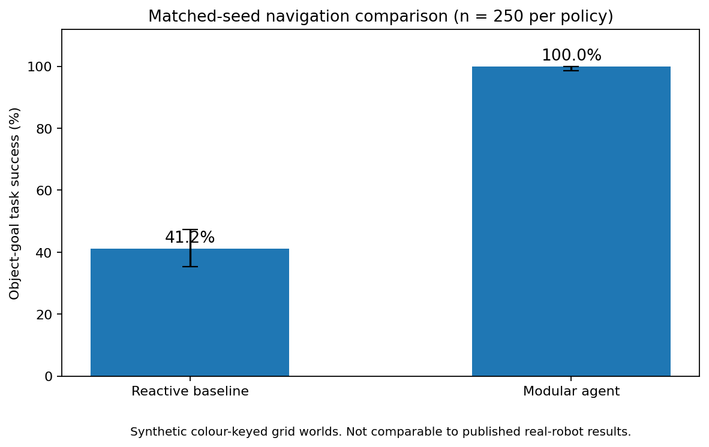

# SemanticNav | Autonomous Object-Goal Navigation

**Status:** Fully runnable, independent **2D simulated robotics prototype**. Not a real robot or an AI2-THOR implementation.

SemanticNav tests how separating **vision, partial mapping, graph search and active exploration** performs against a memoryless reactive navigation strategy in previously unseen worlds.

## Quick start

Requires Python 3.10+, NumPy and Pillow for basic navigation, matplotlib for figures.

```bash
cd SemanticNav
python -m pip install -e ".[viz]"
python -m semanticnav demo --seed 1007
python -m semanticnav bench --episodes 250
python -m pytest -q                # install pytest if needed
```

The demo writes `results/navigation_demo.gif`. The benchmark writes `results/benchmark.json`, `results/episodes.csv`, and `results/benchmark.png`.



## Additional constrained-navigation benchmark (80 steps)

A more demanding experiment with a strict 80-step budget on **250 other matched seeds (4000–4249)** is included at `results/strict_80_step/`. The memoryless reactive comparator reached 58/250 goals (23.20%), while the modular planner reached 245/250 (98.00%). The **74.8-percentage-point difference** is specific to this synthetic simulator and weak, memoryless comparator. It does **not** measure an improvement over the *Science Robotics* paper's published model.

Reproduce exactly (requires Python and dependencies):

```bash
python -m semanticnav bench --seed-start 4000 --episodes 250 --max-steps 80 --output results/strict_80_step
```

The default benchmark (`--max-steps 230`) is intentionally easier; do not confuse its 100% custom success rate with the stricter 98% rate.

## Research and engineering design

```
Unknown rectangular obstacle environment
         │
         ▼
Local synthetic RGB sensor (limited radius, obstacles occlude, Gaussian noise)
         │
         ▼
Perception: classify pixels to unknown / empty / obstacle / goal
         │
         ▼
Persistent partial occupancy + semantic goal map (no ground-truth access)
         │
         ├──── target seen? ──── Yes ──> A* plan to target
         │                                   │
         └──── No ──> score reachable frontier viewpoints by information gain
                                             │
                              One grid-cell move + collision feedback
                                             │
                              Update map and replan on next action
```

### What is independently implemented

- Seeded generation of furnished, connected grid-floorplans, with no prior map access to agents.
- Four-neighbour robot motion, RGB rendered observation, ray-cast occlusions, sensor noise and optional dynamic obstacles.
- Synthetic colour segmentation, cumulative semantic occupancy mapping and object detection.
- A* shortest-path search, BFS reachability, heuristic frontier selection using unknown-cell information gain, replanning every action.
- Deliberately basic but real **memoryless, vision-conditioned random-walk baseline**. This comparison is NOT the neural end-to-end policy used in the published paper.
- Per-seed paired benchmark, success, collision counts, path-efficiency metric, raw CSVs, Wilson 95% confidence intervals, PNG chart and animation.
- 12 automated tests plus matching-seed deterministic evaluation.

### What it does not do

- RGB frames use **colour-coded semantic labels**. Pixel recognition is classical synthetic colour classification, *not* semantic segmentation trained on natural images, and there is no depth camera.
- Movement is deterministic on a 2D grid. There are no motors, SLAM pose uncertainty, continuous kinematics, learned policies, photorealistic textures, or real-world domain shift.
- This is NOT a reimplementation of the published modular neural-navigation system, and no comparison is made with its exact evaluation environments.
- The reactive baseline is intentionally lightweight; higher-quality planners, classical occupancy-grid explorers and learned baselines should be added for rigorous research.

## Measured benchmark

250 matched, previously unused random seeds, **1000 to 1249**; generated 19×19 grids, sensor radius five cells, noise standard deviation 10 RGB levels, one dynamic obstruction when feasible, 230-action budget per trial.

| Method | Successful episodes | Success | Wilson 95% CI | Mean actions | Mean path efficiency |
|---|---:|---:|---|---:|---:|
| Memoryless reactive baseline | 103 / 250 | 41.2% | 35.28% to 47.39% | 175.95 | 0.0904 |
| Modular navigator | 250 / 250 | 100.0% | 98.49% to 100% | 32.23 | 0.6127 |

The improvement is **58.8 percentage points on this custom synthetic benchmark**. These are exact results from the included experiment. They are not generalizable to arbitrary maps, physical robots or the paper's homes. The reported efficiency is `shortest_path / max(shortest_path, actions)` for successful episodes, zero otherwise. It is SPL-like, not a complete physical path-energy metric.

See `results/episodes.csv` for all 500 trajectories' trial summaries, and `results/benchmark.json` for the consolidated metrics.

### Further research upgrades

1. Replace colour-keyed observations with a learned semantic detector for ordinary camera images.
2. Swap the grid simulator for Habitat, AI2-THOR or a ROS 2 environment and account for RGB-D pose uncertainty.
3. Compare against an informed classical explorer and published learned policy in the same environment and action budget.
4. Randomize texture, occlusions, noisy odometry and object categories and report per-layout failure analyses.
5. Implement occupancy likelihood/log-odds and recover from false positive observations.

## Published inspiration and attribution

- Gervet et al., *Navigating to objects in the real world*, Science Robotics (2023), https://doi.org/10.1126/scirobotics.adf6991 . The researchers reported **90% real-home success for a modular approach vs 23% for an end-to-end learned policy**. Their problem, simulator, sensors and agents are substantially more advanced than those here.
- CMU Machine Learning summary: https://blog.ml.cmu.edu/2023/06/30/navigating-to-objects-in-the-real-world/ .

All source in this repo was newly written for this exercise; no original researchers' source files were copied. Conventional A*, BFS, ray-casting and segmentation algorithms are public algorithmic ideas. An independent similarity audit would be needed to certify that no independently authored source resembles existing code.

## Repository map

- `semanticnav/world.py`: simulation, ray-cast camera, occlusion, dynamic obstacles.
- `semanticnav/vision.py`: noisy-image segmentation and occupancy map updates.
- `semanticnav/planning.py`: A* and frontier exploration.
- `semanticnav/agent.py`: modular/reactive agents and episode execution.
- `semanticnav/benchmark.py`: paired trials and confidence intervals.
- `semanticnav/visualize.py`: PNG evaluation and GIF demonstration.
- `tests/`: unit and end-to-end tests.
- `results/`: a fully reproducible evaluation.

## Fair CV wording

> Developed a modular autonomous navigation agent using synthetic RGB perception, occupancy mapping and A* search; attained 100% task completion across 250 held-out procedurally generated grid worlds, outperforming a memoryless reactive baseline (41.2%) under a 230-step limit.

Do **not** claim a 23% to 90% improvement in real-world navigation: those results are from the cited paper, not this project.
